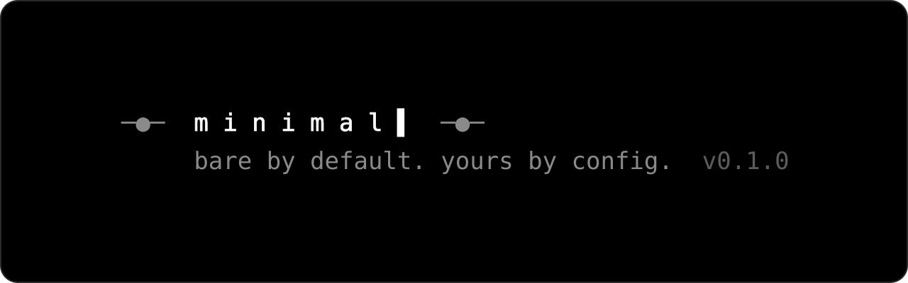
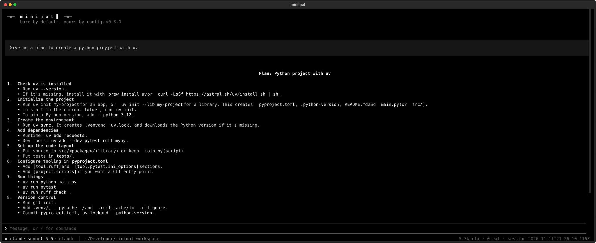
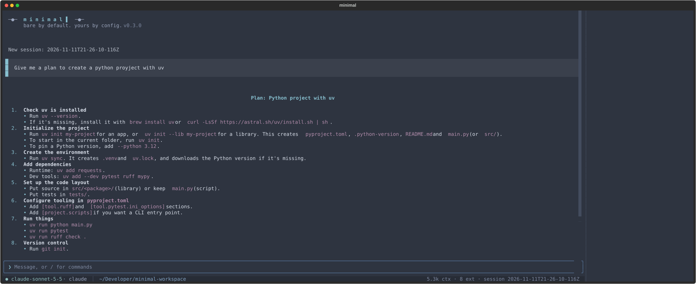
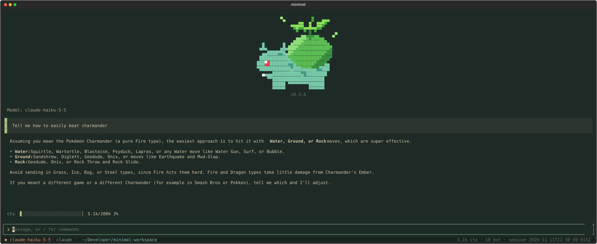
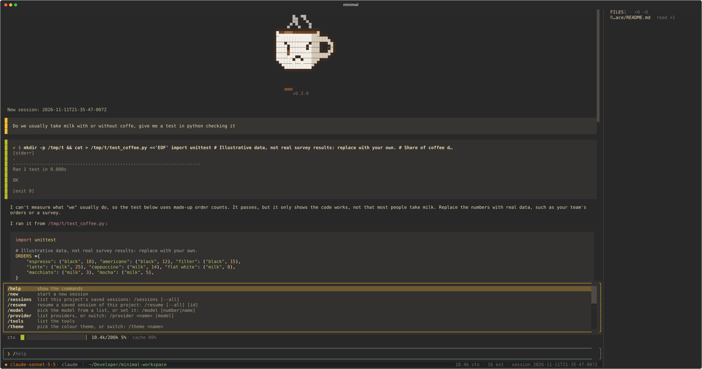
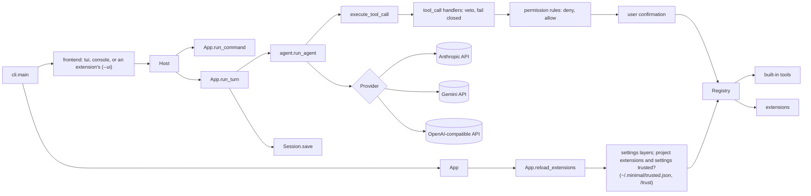

<p align="center">
  
</p>

<h1 align="center">minimal</h1>

<p align="center">
  <a href="https://github.com/RafaSG13/Minimal">Repository</a> · <a href="https://github.com/RafaSG13/minimal-marketplace">Marketplace</a> · <a href="https://github.com/RafaSG13/Minimal/issues">Issues</a>
</p>

<p align="center">
  <a href="https://pypi.org/project/mnml-agent/"></a>
  <a href="https://github.com/RafaSG13/Minimal/actions/workflows/ci.yml"></a>
  
  <a href="LICENSE"></a>
  <br>
  
  
  
  
  <a href="https://github.com/astral-sh/uv"></a>
</p>

**A minimal, extensible coding-agent harness for the terminal.** minimal is a small agent loop — model → tools → model — wrapped in a Textual terminal UI, written so that every piece can be read in one sitting and replaced from a single Python file. Tools, slash commands, providers, hooks, widgets, themes and even the header logo are registered by extensions, and the agent can write, install and hot-reload its own extensions mid-conversation.

Use Claude through an API key or a Pro/Max subscription, Gemini through the free tier, or any OpenAI-compatible server (OpenAI, OpenRouter, Ollama, LM Studio) — and switch providers mid-conversation without losing history. More model integrations are one class away.

<p align="center">
  <a href="assets/screenshots/bare.svg"></a>
  <br><sub><b>Bare by default</b> — a fresh install, no extensions</sub>
</p>

<table>
<tr>
<td width="33%" align="center"><a href="assets/screenshots/custom-theme.svg"></a><br><sub>Colour theme + sidebar</sub></td>
<td width="33%" align="center"><a href="assets/screenshots/custom-bulbasaur.svg"></a><br><sub>Pixel-art logo + context gauge</sub></td>
<td width="33%" align="center"><a href="assets/screenshots/custom-coffee.svg"></a><br><sub>Command menu + files panel</sub></td>
</tr>
</table>
<p align="center"><sub><b>Yours by config</b> — every look above is an extension, written by the model or installed from the marketplace</sub></p>

<table>
<tr><td><b>A real terminal interface</b></td><td>Textual UI with a welcome header, Markdown replies, tool-call blocks coloured by state (running, done, failed), live diffs for edits, a confirm dialog, a command palette (<code>Ctrl+P</code>), <code>Esc</code> to interrupt a turn, and a status line with model, provider, directory, git branch and context size.</td></tr>
<tr><td><b>Provider-neutral history</b></td><td>One canonical message format shaped like the Anthropic Messages API. Each provider converts it on every request, so any session can be resumed with any provider, and <code>/provider</code> switches mid-conversation.</td></tr>
<tr><td><b>Extensions all the way down</b></td><td>A Python file with <code>register(minimal)</code> can add tools, commands, providers, event hooks (tool calls and results, turns, sessions, model requests and their errors), system-prompt notes, sidebar/top/bottom widgets, colour themes and a pixel-art logo.</td></tr>
<tr><td><b>Self-extending, hot-reloaded</b></td><td>The model knows the extension API. It writes an extension, calls <code>reload_extensions</code>, and the new tools are offered on its very next request — in the middle of a turn, without a restart. Load errors go back to the model so it can fix them.</td></tr>
<tr><td><b>Git-based marketplace</b></td><td>Browse, install, update, remove and publish extensions from any git repository with <code>/ext</code>. Publishing opens a pull request; the default branch is never pushed to.</td></tr>
<tr><td><b>Safe by default</b></td><td>Asks before <code>write</code>, <code>edit</code>, <code>bash</code>, <code>reload_extensions</code>, <code>ext_install</code> and <code>ext_publish</code>. Permission rules in settings pre-approve or forbid calls; hooks can veto any tool call or rewrite any result. A project's own extensions run only after <code>/trust</code>, edits never overwrite a file that changed since the model read it, and saved keys are stored with mode <code>0600</code>.</td></tr>
<tr><td><b>Small and readable</b></td><td>Four runtime dependencies, plus Textual for the terminal UI (the <code>tui</code> extra). Every module has a docstring describing its role — start at <code>src/minimal/__init__.py</code>.</td></tr>
</table>

---

## Quick Install

Requires Python 3.11+ and [uv](https://github.com/astral-sh/uv).

### Install the `minimal` command

The package is published on PyPI as `mnml-agent`; the command it installs is `minimal`.

```bash
uv tool install "mnml-agent[tui]"
minimal
```

`[tui]` adds [Textual](https://textual.textualize.io/), which the terminal UI needs. Without it only `minimal --ui console` is available.

### Run from source

```bash
git clone https://github.com/RafaSG13/Minimal.git
cd Minimal
uv sync --extra tui
uv run minimal          # first run: setup, then the terminal UI
uv tool install ".[tui]"  # optional: install the `minimal` command globally
```

On the first start, setup asks (arrow keys) for the default provider, its credentials (a browser login for `claude`; for an API-key provider, the key from the environment or a new one) and the model, then saves the choice in `~/.minimal/settings.json`. It runs again whenever the saved provider can no longer start (for example after `minimal --logout`), and on demand with `minimal --setup` or `/setup`. Without a terminal (a pipe, CI) there is no setup: save a choice first or pass `--provider`.

---

## Getting Started

```bash
minimal                          # interactive terminal UI
minimal --ui console             # plain line-by-line console instead (Ctrl-C interrupts a turn, Ctrl-D quits)
minimal -c                       # resume the last session of this directory
minimal -s <id>                  # open (or create) a specific session
minimal -e extensions/example.py # load an extension file or folder (repeatable)
minimal --setup                  # change the default provider, login/key or model
minimal --login                  # sign in with a Claude Pro/Max subscription
minimal --logout                 # forget the Claude login
minimal -y                       # skip tool confirmations
minimal --trust-project          # apply ./.minimal extensions and trust-gated settings without /trust
minimal ext check [--install-deps] <path>...   # validate extension files, package folders or a marketplace checkout
```

If an `AGENTS.md` exists in the current directory, it is added to the system prompt (`prompt.files` in [settings](#settings) changes which files). minimal needs a terminal, and a turn can only be started from inside its interface: there is no one-shot `minimal -p "prompt"` mode that runs the agent straight from the shell.

**Frontends.** The interface is a frontend: `tui` (the default) or `console`, a plain REPL without colours, widgets or themes. `--ui <name>` or the `ui` setting picks one, and an extension can add another with `register_frontend` (see [docs/extensions.md](docs/extensions.md#frontends)).

**Confirmations.** `write`, `edit`, `bash`, `reload_extensions`, `ext_install` and `ext_publish` ask before running, and so do `read`, `grep` and `glob` for paths outside the working directory, minimal's own source and `~/.minimal/extensions` (a symlink counts where it leads). `-y` skips these questions. `permissions.allow` rules in [settings](#settings) skip them for matching calls (`bash(git status*)`, `write(src/**)`), and `permissions.deny` rules block matching calls even with `-y`. A `tool_call` handler that raises blocks the call. Session files are private to your user (`~/.minimal/sessions`, mode 0700).

**Files.** `edit` replaces one exact, unique piece of text, every occurrence with `replace_all`, or several pieces in one call with `edits` (all or none), and returns the changed lines. `edit` and `write` refuse a file that changed on disk since the model last read, wrote or edited it (you, a formatter or a `bash` command touched it), so the model reads it again instead of overwriting your changes. `read` shows bytes that are not UTF-8 as `�` and does not print binary files.

**Sessions.** A session is open in one minimal at a time: `-c`, `-s` or `/resume` of a session another minimal has open fails and says which process holds it. `/title` names a session; `/sessions` and `/resume` show the title (else the first message) and, for a session an extension started from another one (as `compact` does), the one it came from.

### Providers

| Provider            | `--provider` | Credentials                                                                                                      | Default model       |
| ------------------- | ------------ | ---------------------------------------------------------------------------------------------------------------- | ------------------- |
| Anthropic           | `anthropic`  | `ANTHROPIC_API_KEY` or a key saved in setup                                                                      | `claude-sonnet-5-5` |
| Claude subscription | `claude`     | Browser login in setup, `minimal --login` or `/login`                                                            | `claude-sonnet-5-5` |
| Google Gemini       | `gemini`     | `GEMINI_API_KEY` / `GOOGLE_API_KEY` or a key saved in setup ([get one](https://aistudio.google.com/docs/api-key), free tier) | `gemini-3.8-flash`  |
| OpenAI-compatible   | `openai`     | `OPENAI_API_KEY` or a key saved in setup; `OPENAI_BASE_URL` points it at OpenRouter, Ollama, LM Studio (local servers accept any key) | `gpt-5.5`           |

**Resolution order.** Provider: `--provider` → `MINIMAL_PROVIDER` → `provider` in [settings](#settings). Model: `-m` → `MINIMAL_MODEL` → `model` in settings (if the provider is the settings' one) → the provider's default. Keys entered in setup are saved in `~/.minimal/keys.json` and take precedence over environment variables. They are removed from the environment of `bash` commands; export a key in your shell instead (and remove it from `keys.json`) if commands need it.

### Slash commands

| Command                      | What it does                                                               |
| ---------------------------- | -------------------------------------------------------------------------- |
| `/help`                      | Show the commands, including those added by extensions                     |
| `/new`, `/sessions [--all]`  | Start a new session, list this project's saved sessions (every project's with `--all`) |
| `/resume [--all] [id]`       | Resume a saved session of this project: pick one of the latest (`--all`: of any project), or give an id |
| `/title [text]`              | Show or set this session's title                                           |
| `/model [number\|name]`      | List models, or change model                                               |
| `/provider [name [model]]`   | List providers, or switch for this session and keep the conversation       |
| `/tools`                     | List the tools                                                             |
| `/theme [name]`              | Pick the colour theme; the choice is saved in `~/.minimal/settings.json` (terminal UI only) |
| `/reload`                    | Reload extensions and settings from disk                                   |
| `/settings`                  | Show the settings files and each effective setting with where it comes from |
| `/trust`                     | Scan this project's extensions and trust-gated settings, then choose whether to trust and apply them |
| `/ext …`                     | Install, update, remove, list and publish extensions (also `/extensions`)  |
| `/setup`, `/login`, `/logout`| Change the saved default, sign in to Claude, forget the login              |
| `/exit`                      | Quit (also `/quit` and `Ctrl+Q`)                                           |

`/setup` and `/login` run with the UI suspended, in the plain terminal. `/setup` changes the saved default; `/provider` only affects the current session.

`Esc` interrupts the turn in progress: a running `bash` command is killed. It takes effect at the next streamed chunk, tool call or model request. If the model had already replied, the turn stays in the history, closed with a `[turn interrupted: …]` note and an error result for each tool call that had not finished, so the model still knows what it did; otherwise the turn is dropped and the same prompt can be sent again. Interrupting during an automatic compaction (the `compact` extension) aborts it and keeps the answer. Resuming a session (`-c`, `-s`, `/resume`) redraws its last 200 messages in the transcript.

Typing `/` and part of a command suggests the rest; `→` accepts it. Click a tool call to expand its output (up to 500 lines) and again to collapse it; edits show a diff with the file's line numbers, and `read`/`write` show syntax-highlighted code. `Ctrl+B` hides or shows the sidebar.

### Environment

| Variable                          | Purpose                                                                                     |
| --------------------------------- | ------------------------------------------------------------------------------------------- |
| `ANTHROPIC_API_KEY`               | Key for `--provider anthropic`                                                              |
| `GEMINI_API_KEY` / `GOOGLE_API_KEY` | Key for `--provider gemini`                                                               |
| `OPENAI_API_KEY`, `OPENAI_BASE_URL` | Key for `--provider openai`, and the server it talks to (default: OpenAI)                 |
| `MINIMAL_PROVIDER`, `MINIMAL_MODEL` | Default provider and model                                                                |
| `MINIMAL_MARKETPLACE`             | Git URL or local path of a marketplace used by the model's tools and listed first by `/ext` |

---

## Settings

Settings are layered JSON files: `~/.minimal/settings.json` (global) < `.minimal/settings.json` (project, shared with the repository) < `.minimal/settings.local.json` (local, personal), then the environment, then the command line. They hold the provider, model and theme, extra prompt text and prompt files, permission rules, disabled extensions and per-extension settings, and (global only) the marketplaces and base prompt. `/settings` shows where each value comes from.

```json
{
  "theme": "dark",
  "permissions": {"allow": ["bash(git status*)", "write(src/**)"], "deny": ["read(.env)"]},
  "extensions": {"disabled": ["widgets/token_sparkline"], "settings": {"compact": {"compact_at": 150000}}}
}
```

A project's `permissions.allow`, `extensions.disabled` and `extensions.settings` apply only after `/trust`. The keys, merge rules, permission syntax and examples are in [docs/settings.md](docs/settings.md).

---

## Extensions

An extension is a Python file, or a folder with an `__init__.py`, defining `register(minimal)`. Extensions are loaded from `~/.minimal/extensions/`, `./.minimal/extensions/` and any path passed with `--ext`; names starting with `_` or `.` are skipped. Each folder's own entries load first, then those in its `themes/`, `tools/` and `widgets/` subfolders, where the marketplace installs those categories. `extensions.disabled` in [settings](#settings) skips some by id.

A project's `./.minimal/extensions/` is code from the repository, so minimal does not run it until you trust it. Untrusted, it is skipped without asking: the transcript says so and the status line shows `⚠ N untrusted`. `/trust` prints a static scan of each file (what it can do: run commands, use the network, read environment variables or credential files, write files, decode hidden data, hook tool calls…; a list of capabilities, not of intent) and the project's trust-gated settings, and asks once. The answer is remembered for exactly what was scanned (`~/.minimal/trusted.json`); adding or editing a file or one of those settings makes the project untrusted again, including files written by the model or installed by `/ext`. `--trust-project` applies them without `/trust`; `-y` does not.

```python
"""Blocks force pushes and tells the time."""

from datetime import datetime

__version__ = "1.0"
__api__ = "1"


def register(minimal):
    settings = minimal.declare_settings({"blocked": "git push --force"})   # extensions.settings.<id> in settings.json

    @minimal.tool(input_schema={"type": "object", "properties": {}})
    def now(input, ctx):
        """Return the current date and time."""
        return datetime.now().isoformat()

    @minimal.command(description="show the session size")
    def stats(args, ctx):
        print(f"{len(ctx.messages)} messages · {ctx.model}")

    @minimal.on("tool_call")
    def guard(event):
        if settings["blocked"] in event["input"].get("command", ""):
            return {"block": True, "reason": "blocked by settings"}

    minimal.append_system_prompt("Always reply in the user's language.")
```

`register(minimal)` receives an `Extension` with decorators and `register_*` methods for tools, commands, providers, events, prompt notes, widgets, status segments, themes and a header logo, plus `declare_settings`, `data_dir()` (a private folder outside the repository for the extension's state) and `on_dispose` (cleanup before a reload or exit). Tools, commands, events and widgets receive a `Context` as `ctx`: the session, model and tools, `ctx.ui` for questions, `ctx.notify` for notices, `ctx.complete` and `ctx.run_agent` for model calls, `ctx.new_session`, `ctx.use_provider` and `ctx.queue_user_message`. Import anything else only from `minimal.api`. Errors raised by a tool are returned to the model as an `is_error` result, so it can correct itself. **[docs/extensions.md](docs/extensions.md)** is the full guide: package folders, metadata (`__version__`, `__api__`, `__dependencies__`), every member, event payloads, settings, widgets, themes, logos and publishing. See [`extensions/example.py`](extensions/example.py) for a complete extension with a tool, a command, a guardrail with a setting, a prompt note and a sidebar widget.

Compaction (`compact`), retries with backoff and a fallback provider (`retry`), the `subagent` tool and the `web_search` tool ([Brave Search API](https://api-dashboard.search.brave.com), needs `BRAVE_API_KEY`) are installed from the default marketplace with `/ext`.

### Self-extension and hot reload

The model knows how to write extensions: the system prompt explains the API and where to save them. After writing or editing one, it calls the `reload_extensions` tool, which asks for confirmation like `write` (skipped with `-y`). Reloading rebuilds the registry from disk in place, so new tools are offered on the model's next request — even in the middle of a turn — and widgets are remounted without restarting. Load errors are returned to the model so it can fix them. Reload manually with `/reload`.

---

## Marketplace

Extensions are shared through a git repository with one folder per category: `extensions/` (general), `themes/` (colour themes), `tools/` (tools for the model) and `widgets/` (terminal UI components). Each holds `<name>.py` files or `<name>/` package folders whose docstring's first line is the description, with a required `__version__ = "1.0"` and the `__api__ = "1"` of the minimal API it is written for. Third-party packages go in an optional `__dependencies__ = ["termaid>=0.3"]`: `/ext` offers to install the missing ones into minimal's Python. Installing mirrors the category, so `themes/amber.py` goes to `~/.minimal/extensions/themes/amber.py`. Before publishing, `minimal ext check <path>` (or `minimal ext check .` in a marketplace checkout; `--install-deps` installs the declared packages first) loads each item without a terminal and prints `ok`, `WARN` (a missing optional module) or `FAIL`; it exits 1 on any failure.

Versions come from the repository's git history. For each item minimal takes the newest commit that touched it whose `__api__` this minimal can run: HEAD's version if it can, else the latest older one (shown as "latest for this minimal (newer needs API 2)"). An item with no such version is shown but not installed. Each extensions folder, global and project, keeps a `.lock.json` (ignored by the loader) recording, per installed item, its marketplace, commit, `__version__`, `__api__` and the SHA-256 of the installed files. An item is "update available" when its commit is not the one on offer, not merely when its bytes differ, so editing an installed copy is no longer mistaken for an update. An edited copy is marked "local changes": `/ext` leaves it unticked in the "Update these?" list (ticking it overwrites it) and the model's `ext_install` refuses to replace it unless called with `force: true`. A copy without a lock entry (installed by hand or by an older minimal) is still compared byte by byte.

The default marketplace is [`RafaSG13/minimal-marketplace`](https://github.com/RafaSG13/minimal-marketplace). `MINIMAL_MARKETPLACE` adds another URL or local path (for example your fork) and makes it the one the model's tools use.

```
/ext                              pick a marketplace and a category, then tick items to install, update or remove
/ext list                         list installed items by scope and category
/ext publish <path> [name]        push a publish/<name>-<timestamp> branch and open a pull request (with `gh`)
```

`/ext` lists the default marketplace, `$MINIMAL_MARKETPLACE` and the ones you added. "Add a marketplace…" takes a git URL or a local path, checks that it can be cloned and saves it under `marketplaces` in `~/.minimal/settings.json`; "Remove a saved marketplace…" forgets one. Picking a marketplace shows its categories with item and install counts; picking a category shows a checklist with installed items ticked. Tick to install (then choose the global or the project folder), untick to uninstall; items with a newer version on offer are offered for update. `Space` toggles, `Enter` applies, `Esc` cancels; extensions are reloaded afterwards. `/ext publish` files an extension under the category of the folder it comes from (`~/.minimal/extensions/themes/x.py` → `themes/`), else under `extensions/`.

The model has the `ext_search`, `ext_install` and `ext_publish` tools (each takes an optional `category`). `ext_search` searches every configured marketplace; `ext_install` and `ext_publish` take an optional `marketplace` (one of those URLs), and otherwise install from the marketplace that has the item and publish to `$MINIMAL_MARKETPLACE` or the default; `ext_install` also takes `force` to overwrite a copy with local changes. The model must call `reload_extensions` after installing. Publishing never pushes to the default branch: without push access, fork the marketplace and point `MINIMAL_MARKETPLACE` at the fork.

**Installing globally.** Extensions in `~/.minimal/extensions/` run in every project without `/trust`, so before anything is installed or updated there (from `/ext` or with `ext_install`) minimal prints the same static scan as `/trust` for those extensions and asks once; answering no installs nothing. Project installs are not asked about here: the project's extensions are scanned by `/trust` before they run.

---

## Architecture



**One user turn.** `App.run_turn` appends the user message and calls `run_agent`. The loop asks the current provider for a reply; `before_request` handlers may change what one request sends (a summary instead of a long history, say), and a failed request goes to `provider_error` handlers, which may retry it or switch provider. If the reply calls tools, each call goes through `tool_call` handlers (which can veto it; one that raises blocks it), permission rules (a deny fails the call, an allow skips the question), user confirmation, the tool itself, and `tool_result` handlers (which can rewrite the output). The results go back to the model, and this repeats until it answers without tools. If a turn fails or is interrupted before the model replied, it is dropped from the history; after that, it is kept, with the finished tool results, an error for each call not finished and a closing `[turn interrupted: …]` note. A reply cut off by the output token limit never runs its tool calls: each gets an error asking for smaller steps. The session file is appended to after every turn.

**Frontends.** A frontend drives minimal through a `Host` (`core/host.py`): send a message, run a command, interrupt, read the status and what extensions add to the interface; it shows minimal through a `Frontend` (`core/app.py`) that it attaches to the host. The terminal UI and the `console` REPL (`ui/frontends.py`) are registered like any extension's frontend, so `--ui` picks one and an extension can replace them by name; `import minimal.api` loads no UI toolkit. In the terminal UI, turns and slash commands run in a worker thread; streamed text, tool calls, tool results and confirmation dialogs are handed to the UI thread, and anything printed appears in the transcript.

**History.** Stored in one provider-neutral format shaped like the Anthropic Messages API (see `providers/base.py`). Each provider converts it to its own API on every request. When a provider must replay its own replies exactly (Gemini's thought signatures), it keeps that data in the message's `provider_data`; other providers ignore it. Assistant messages also record the request's token `usage` when the provider reports it, which is where the status line's context size comes from. Requests to Anthropic use prompt caching, so the unchanged start of the history is not paid for again.

<details>
<summary><b>Project layout</b></summary>

```
src/minimal/         packages from the bottom up; each imports only from the ones above it
  config.py          layered settings (settings.json global/project/local), API keys, trust records
  glyphs.py          the symbols every frontend draws with (minimal.api.theme)
  providers/
    base.py          Provider interface, Reply, Usage, canonical message format
    anthropic.py     Claude via the Anthropic Messages API (API key)
    claude.py        Claude via a Pro/Max subscription (browser login)
    claude_auth.py   browser login (OAuth PKCE) and token storage (~/.minimal/claude-auth.json)
    gemini.py        Gemini via the Google Interactions API
    openai.py        OpenAI-compatible servers via the Chat Completions API
  extensions/
    registry.py      internal Registry, Tool, Command, WidgetSpec: tools, commands, providers, hooks, widgets, themes, logo
    facade.py        Extension: what an extension's register(minimal) receives (decorators, declare_settings)
    metadata.py      reads docstring, __version__, __api__ and __frontend__ without running the code; API version checks
    loader.py        finds extension files and package folders, imports them and calls their register(minimal)
    audit.py         static scan of extension source for /trust: what a file can do
    marketplace.py   git-based marketplaces: list, search, install, publish, `minimal ext check` (~/.minimal/marketplace cache)
    logo.py          python -m minimal.extensions.logo: turns an image into a header-logo extension (needs Pillow)
  tools/
    common.py        output clipping, which paths are read without asking
    files.py         read, write, edit
    shell.py         bash
    search.py        grep, glob
    reload.py        reload_extensions
    builtin.py       the list of built-in tools
  core/
    agent.py         agent loop (model → tools → model …)
    app.py           App: runtime state, settings, provider switching, system prompt, one user turn, extension reload, Frontend
    host.py          Host: what a frontend drives minimal with
    context.py       Context and UI: the ctx extensions receive
    permissions.py   permission rules: allow/deny matching for tool calls
    session.py       JSONL sessions (~/.minimal/sessions)
    prompt.md        packaged base prompt
  ui/
    commands.py      slash commands (/help, /provider, /reload, /settings, /trust, /ext, …)
    frontends.py     the built-in frontends: tui and the console REPL
    setup.py         onboarding wizard: provider, login or API key, model
    tui/
      app.py         MinimalTui: transcript, prompt, status line, widget and panel areas; run_tui
      widgets.py     tool-call blocks, extension panels, styled-text helpers and the welcome header
      markdown.py    the transcript's Markdown: fences and alert quotes drawn by extension renderers
      screens.py     dialogs: confirmation and pickers
      frontend.py    TuiFrontend: how turns in worker threads reach the UI
      theme.py       built-in theme, extension themes for Textual; /theme lives in frontend.py
  cli.py             option parsing, entry point, `minimal ext check`
  api.py             the only module extensions import from: Extension, Context, Host, event types, glyphs, …
extensions/
  example.py         example extension (tool, command, guardrail with a setting, prompt note, sidebar widget)
tests/               unittest suite (see Development)
```

</details>

### Adding a provider

A provider is a class with a `name` and a `stream(*, model, system, messages, tools, on_text, options=None) -> Reply` method (see `providers/base.py`). `options` holds request options such as `max_tokens` and `temperature`; minimal passes it only when one is set, and a provider ignores keys it does not know:

1. Convert the canonical `messages` and `tools` to the API's request format.
2. Stream the response, calling `on_text(chunk)` for text as it arrives.
3. Return `Reply(content=[text/tool_use blocks], stop_reason="tool_use" | "end_turn" | ..., provider_data=...)`.

Register it as a built-in in `providers/__init__.py` (`BUILTIN_PROVIDERS`), or from an extension with `minimal.register_provider(...)`. `providers/gemini.py` is a complete example, including the history conversion.

---

## Development

```bash
uv sync --extra tui
uv run ruff check
uv run mypy
uv run coverage run -m unittest discover -s tests && uv run coverage report
```

CI runs the same on Ubuntu and macOS with Python 3.11–3.13 (`coverage report` fails below the threshold in `pyproject.toml`), and checks every item of the default marketplace with `minimal ext check`. Plain `uv run python -m unittest discover -s tests` runs the suite without coverage. The suite needs no network or API key. It covers:

| Test file             | What's covered                                                                                   |
| --------------------- | ------------------------------------------------------------------------------------------------ |
| `test_smoke.py`       | Tools, extensions, hot reload, the agent loop with a fake provider, interruption, sessions, logo validation |
| `test_providers.py`   | Provider conversions (Gemini and OpenAI history/streaming, Anthropic/Claude requests, token usage) |
| `test_claude_auth.py` | Browser login round trip, token refresh                                                          |
| `test_config.py`      | Saved keys, how the startup provider is chosen                                                   |
| `test_settings.py`    | Settings layers and precedence, validation errors, trust-gated keys, prompt files |
| `test_permissions.py` | Allow/deny rules for bash, paths and extension tools; deny with `-y`; shell operators             |
| `test_extension_api.py` | The `Extension` and `Context` facades: decorators, events, settings, sessions, commands, nested agents, package folders, `__api__`, disabling |
| `test_security.py`    | Trust digests and the `/trust` scan                                                              |
| `test_marketplace.py` | Search, install, publish, package folders, versions, the `/ext` picker, saved marketplaces and `minimal ext check`, against local bare git repos |
| `test_tui.py`         | The headless terminal UI: streaming, interruption, session replay, dialogs, tool-call states, command output, widgets, header |
| `test_logo.py`        | The image-to-logo converter (skipped without Pillow)                                             |
| `test_frontends.py`   | Frontends: the console REPL, `--ui` with an extension's frontend, frontend commands, `minimal.api` without Textual |
| `test_bundled_extensions.py` | Marketplace items through `App`: web search, subagent, compaction (also in the middle of a turn), retries, scope fence. Loads them from `../minimal-marketplace` or `$MARKETPLACE_CHECKOUT`; skipped without a checkout |

---

## Contributing

Issues and pull requests are welcome at [RafaSG13/Minimal](https://github.com/RafaSG13/Minimal/issues); changes are listed in the [CHANGELOG](CHANGELOG.md). Extensions belong in the [marketplace](https://github.com/RafaSG13/minimal-marketplace) — publish one straight from the app with `/ext publish <path>`.

Licensed under the [MIT License](LICENSE).

Built by [RafaSG13](https://github.com/RafaSG13).
