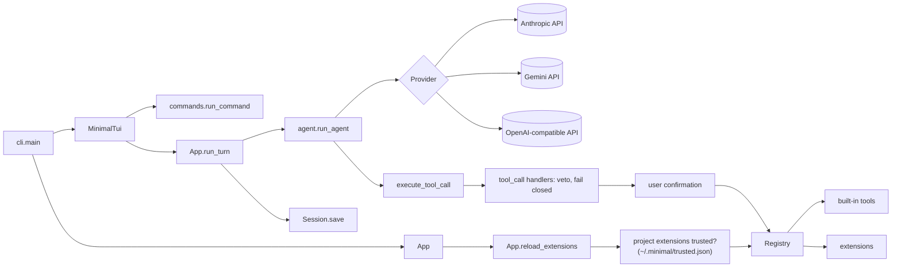

<p align="center">
  
</p>

<h1 align="center">minimal</h1>

<p align="center">
  <a href="https://github.com/RafaSG13/Minimal">Repository</a> · <a href="https://github.com/RafaSG13/minimal-marketplace">Marketplace</a> · <a href="https://github.com/RafaSG13/Minimal/issues">Issues</a>
</p>

<p align="center">
  
  
  
  
  
  <a href="https://github.com/astral-sh/uv"></a>
</p>

**A minimal, extensible coding-agent harness for the terminal.** minimal is a small agent loop — model → tools → model — wrapped in a Textual terminal UI, written so that every piece can be read in one sitting and replaced from a single Python file. Tools, slash commands, providers, hooks, widgets, themes and even the header logo are registered by extensions, and the agent can write, install and hot-reload its own extensions mid-conversation.

Use Claude through an API key or a Pro/Max subscription, Gemini through the free tier, or any OpenAI-compatible server (OpenAI, OpenRouter, Ollama, LM Studio) — and switch providers mid-conversation without losing history. More model integrations are one class away.

<table>
<tr><td><b>A real terminal interface</b></td><td>Textual UI with a welcome header, Markdown replies, tool-call blocks coloured by state (running, done, failed), live diffs for edits, a confirm dialog, a command palette (<code>Ctrl+P</code>), <code>Esc</code> to interrupt a turn, and a status line with model, provider, directory, git branch and context size.</td></tr>
<tr><td><b>Provider-neutral history</b></td><td>One canonical message format shaped like the Anthropic Messages API. Each provider converts it on every request, so any session can be resumed with any provider, and <code>/provider</code> switches mid-conversation.</td></tr>
<tr><td><b>Extensions all the way down</b></td><td>A Python file with <code>register(minimal)</code> can add tools, commands, providers, <code>tool_call</code>/<code>tool_result</code>/<code>turn_end</code> hooks, system-prompt notes, sidebar/top/bottom widgets, colour themes and a pixel-art logo.</td></tr>
<tr><td><b>Self-extending, hot-reloaded</b></td><td>The model knows the extension API. It writes an extension, calls <code>reload_extensions</code>, and the new tools are offered on its very next request — in the middle of a turn, without a restart. Load errors go back to the model so it can fix them.</td></tr>
<tr><td><b>Git-based marketplace</b></td><td>Browse, install, update, remove and publish extensions from any git repository with <code>/ext</code>. Publishing opens a pull request; the default branch is never pushed to.</td></tr>
<tr><td><b>Safe by default</b></td><td>Asks before <code>write</code>, <code>edit</code>, <code>bash</code>, <code>reload_extensions</code>, <code>ext_install</code> and <code>ext_publish</code>. Hooks can veto any tool call or rewrite any result. Saved keys are stored with mode <code>0600</code>.</td></tr>
<tr><td><b>Small and readable</b></td><td>Five runtime dependencies. Every module has a docstring describing its role — start at <code>src/minimal/__init__.py</code>.</td></tr>
</table>

---

## Quick Install

Requires Python 3.11+ and [uv](https://github.com/astral-sh/uv).

### Install the `minimal` command

```bash
uv tool install git+https://github.com/RafaSG13/Minimal.git
minimal
```

### Run from source

```bash
git clone https://github.com/RafaSG13/Minimal.git
cd Minimal
uv sync
uv run minimal          # first run: setup, then the terminal UI
uv tool install .       # optional: install the `minimal` command globally
```

On the first start, setup asks (arrow keys) for the default provider, its credentials (a browser login for `claude`; for an API-key provider, the key from the environment or a new one) and the model, then saves the choice in `~/.minimal/config.json`. It runs again whenever the saved provider can no longer start (for example after `minimal --logout`), and on demand with `minimal --setup` or `/setup`. Without a terminal (a pipe, CI) there is no setup: save a choice first or pass `--provider`.

---

## Getting Started

```bash
minimal                          # interactive terminal UI
minimal -c                       # resume the last session
minimal -s <id>                  # open (or create) a specific session
minimal -e extensions/example.py # load an extension file or folder (repeatable)
minimal --setup                  # change the default provider, login/key or model
minimal --login                  # sign in with a Claude Pro/Max subscription
minimal --logout                 # forget the Claude login
minimal -y                       # skip tool confirmations
minimal --trust-project          # load ./.minimal/extensions without asking
```

If an `AGENTS.md` exists in the current directory, it is added to the system prompt. minimal needs a terminal, and a turn can only be started from inside its interface: there is no one-shot `minimal -p "prompt"` mode that runs the agent straight from the shell.

**Confirmations.** `write`, `edit`, `bash`, `reload_extensions`, `ext_install` and `ext_publish` ask before running, and so do `read`, `grep` and `glob` for paths outside the working directory, minimal's own source and `~/.minimal/extensions` (a symlink counts where it leads). `-y` skips these questions. A `tool_call` handler that raises blocks the call. Session files are private to your user (`~/.minimal/sessions`, mode 0700).

### Providers

| Provider            | `--provider` | Credentials                                                                                                      | Default model       |
| ------------------- | ------------ | ---------------------------------------------------------------------------------------------------------------- | ------------------- |
| Anthropic           | `anthropic`  | `ANTHROPIC_API_KEY` or a key saved in setup                                                                      | `claude-sonnet-5-5` |
| Claude subscription | `claude`     | Browser login in setup, `minimal --login` or `/login`                                                            | `claude-sonnet-5-5` |
| Google Gemini       | `gemini`     | `GEMINI_API_KEY` / `GOOGLE_API_KEY` or a key saved in setup ([get one](https://aistudio.google.com/docs/api-key), free tier) | `gemini-3.8-flash`  |
| OpenAI-compatible   | `openai`     | `OPENAI_API_KEY` or a key saved in setup; `OPENAI_BASE_URL` points it at OpenRouter, Ollama, LM Studio (local servers accept any key) | `gpt-5.5`           |

**Resolution order.** Provider: `--provider` → `MINIMAL_PROVIDER` → the one saved by setup. Model: `-m` → `MINIMAL_MODEL` → the one saved by setup (if the provider is the saved one) → the provider's default. Keys entered in setup are saved in `~/.minimal/keys.json` and take precedence over environment variables. They are removed from the environment of `bash` commands; export a key in your shell instead (and remove it from `keys.json`) if commands need it.

### Slash commands

| Command                      | What it does                                                               |
| ---------------------------- | -------------------------------------------------------------------------- |
| `/help`                      | Show the commands, including those added by extensions                     |
| `/new`, `/sessions`          | Start a new session, list saved sessions                                   |
| `/resume [id]`               | Resume a saved session: pick one of the latest, or give its id             |
| `/model [number\|name]`      | List models, or change model                                               |
| `/provider [name [model]]`   | List providers, or switch for this session and keep the conversation       |
| `/tools`                     | List the tools                                                             |
| `/theme [name]`              | Pick the colour theme; the choice is saved in `~/.minimal/theme.json`      |
| `/reload`                    | Reload extensions from disk                                                |
| `/ext …`                     | Install, update, remove, list and publish extensions                       |
| `/setup`, `/login`, `/logout`| Change the saved default, sign in to Claude, forget the login              |
| `/exit`                      | Quit (also `Ctrl+Q`)                                                       |

`/setup` and `/login` run with the UI suspended, in the plain terminal. `/setup` changes the saved default; `/provider` only affects the current session.

`Esc` interrupts the turn in progress: a running `bash` command is killed and the turn is dropped from the history, as when it fails. It takes effect at the next streamed chunk, tool call or model request. Interrupting during an automatic compaction aborts it and drops the turn like any other interrupt. Resuming a session (`-c`, `-s`, `/resume`) redraws its last 200 messages in the transcript.

Typing `/` and part of a command suggests the rest; `→` accepts it. Click a tool call to expand its output (up to 500 lines) and again to collapse it; edits show a diff with the file's line numbers, and `read`/`write` show syntax-highlighted code. `Ctrl+B` hides or shows the sidebar.

### Environment

| Variable                          | Purpose                                                                                     |
| --------------------------------- | ------------------------------------------------------------------------------------------- |
| `ANTHROPIC_API_KEY`               | Key for `--provider anthropic`                                                              |
| `GEMINI_API_KEY` / `GOOGLE_API_KEY` | Key for `--provider gemini`                                                               |
| `OPENAI_API_KEY`, `OPENAI_BASE_URL` | Key for `--provider openai`, and the server it talks to (default: OpenAI)                 |
| `MINIMAL_PROVIDER`, `MINIMAL_MODEL` | Default provider and model                                                                |
| `MINIMAL_MARKETPLACE`             | Git URL or local path of a marketplace used by the model's tools and listed first by `/ext` |

---

## Extensions

An extension is a Python file defining `register(minimal)`. Extensions are loaded from `~/.minimal/extensions/`, `./.minimal/extensions/` and any path passed with `--ext`; files starting with `_` or `.` are skipped. Each folder's own files load first, then those in its `themes/`, `tools/` and `widgets/` subfolders, where the marketplace installs those categories.

A project's `./.minimal/extensions/` is code from the repository, so minimal asks before running it and remembers the answer for exactly those files (`~/.minimal/trusted.json`); adding or editing a file asks again. Refused or unanswered (no terminal), they are skipped with a message. `--trust-project` loads them without asking; `-y` does not.

```python
def register(minimal):
    minimal.register_tool(name="hello", description="...", input_schema={...}, run=lambda input, ctx: "text")
    minimal.register_command("hi", lambda args, ctx: print("hi", args), description="say hi")
    minimal.register_command("wizard", run_wizard, terminal=True)                  # needs the real terminal
    minimal.register_provider("myllm", create=MyProvider, default_model="my-model", env_keys=("MYLLM_KEY",))
    minimal.on("tool_call", lambda e: {"block": True, "reason": "no"})              # veto a call
    minimal.on("tool_result", lambda e: {"output": e["output"].upper()})            # rewrite a result
    minimal.on("turn_end", lambda e: None)                                          # e["messages"], e["ctx"]
    minimal.append_system_prompt("Extra instructions for the model.")
    minimal.register_widget("panel", lambda ctx: MyPanel(), area="sidebar")         # top, bottom or sidebar
    minimal.register_status("cost", lambda ctx: "$0.12", side="right")              # status-line segment, or None
    minimal.register_theme("ocean", dark=True, background="#0b1622", foreground="#d0e4f5", accent="#4fc3f7")
    minimal.register_logo(["#.#", "###"], {"#": "#4fc3f7"}, align="center")         # pixel art in the header
```

`ctx` exposes `cwd`, `messages`, `provider_name`, `model` and `registry`. Errors raised by a tool are returned to the model as an `is_error` result, so it can correct itself. See [`extensions/example.py`](extensions/example.py) for a complete extension with a tool, a command, a guardrail, a prompt note and a sidebar widget.

The repository has three more, loaded the same way (`minimal -e extensions/compact.py`) or copied to `~/.minimal/extensions/` (tools in its `tools/` subfolder):

| Extension                        | What it adds                                                                                                                                              |
| -------------------------------- | --------------------------------------------------------------------------------------------------------------------------------------------------------- |
| `extensions/compact.py`          | Summarises the conversation into a new session when the context reaches 100k tokens, and on demand with `/compact`. The old session stays on disk: `/resume <id>` brings it back |
| `extensions/tools/subagent.py`   | `subagent` tool: runs a task in a fresh agent loop with the same tools and an empty history; only its final message returns to the conversation           |
| `extensions/tools/web_search.py` | `web_search` tool: results from the [Brave Search API](https://api-dashboard.search.brave.com) (needs `BRAVE_API_KEY`)                                    |

<details>
<summary><b>Widgets</b></summary>

A widget is any [Textual](https://textual.textualize.io/) widget, styled with its own `DEFAULT_CSS`. Besides Textual's standard variables (`$primary`, `$surface`, …), the CSS can use the theme's own: `$muted`, `$dim`, `$border-muted`, `$user-message-bg`, `$tool-success-bg`, … (see `theme.py`). If it has a `refresh_state(ctx)` method, the UI calls it after mount, after every turn and command, and after every reload. If it has a `refresh_live(ctx, event)` method, the UI calls it while a turn runs: when a turn or command starts (`{"kind": "start", "turn": bool}`), after each tool call is shown (`{"kind": "tool_call", "call": …}`) and after each result (`{"kind": "tool_result", "call": …, "result": …}`; the result is not in `ctx.messages` until every call of that reply has finished). The `top` and `bottom` areas size to their content: give the widget a height and don't `dock` it.

`register_status(name, render, side)` adds a segment to the status line, `left` after the git branch or `right` before the context size. `render(ctx)` returns text, a `textual.content.Content` or `None` for no segment; it runs on every redraw, so keep it cheap. A segment that raises is skipped and reported once.

</details>

<details>
<summary><b>Themes</b></summary>

A theme needs `background`, `foreground` and `accent` (`#rrggbb`); the other colours (`surface`, `muted`, `error`, `user_bg`, `diff_added`, … see `Registry.register_theme`) are optional and derived when left out. The built-in theme is `minimal` (black and white) and cannot be replaced; `amber`, `dark` and `light` are in the marketplace's `themes/` (install them with `/ext` → Themes). Registered themes appear in `/theme` and `Ctrl+P` → Theme. If a reload removes the active theme, the UI goes back to `minimal`.

</details>

<details>
<summary><b>Header logo</b></summary>

Without a logo, the welcome header is a left-aligned wordmark, `─●─  m i n i m a l ▌  ─●─`, with the tagline `bare by default. yours by config.` and the version under it. A logo replaces the wordmark with pixel art; `align` (`"left"`, `"center"` by default, or `"right"`) places it and the header text under it.

`art` is a list of equal-length strings, one character per pixel (`" "` or `"."` transparent); `colors` maps every other character to `#rrggbb` or a theme variable such as `$accent` or `$foreground`, so the logo can follow `/theme`. Two pixel rows make one terminal row, drawn with half blocks (`▀▄█`) in truecolor. The last logo loaded wins. The marketplace's `widgets/logo.py` is a gradient pixel-art M with the `minimal` wordmark; its colours are constants at the top of the file.

To make a logo from any image (pixel art or a picture), convert it with Pillow, which minimal does not depend on:

```bash
uv run --with pillow python -m minimal.logo logo.png -w 24 -o ~/.minimal/extensions/widgets/logo.py   # then /reload
```

`-w` is the width in pixels (one terminal column each; images only shrink), `-c` the most colours to keep (default 16; pixel art with no more keeps its exact colours), `--nearest` resizes without smoothing. Without `-o` the extension is printed.

</details>

### Self-extension and hot reload

The model knows how to write extensions: the system prompt explains the API and where to save them. After writing or editing one, it calls the `reload_extensions` tool, which asks for confirmation like `write` (skipped with `-y`). Reloading rebuilds the registry from disk in place, so new tools are offered on the model's next request — even in the middle of a turn — and widgets are remounted without restarting. Load errors are returned to the model so it can fix them. Reload manually with `/reload`.

---

## Marketplace

Extensions are shared through a git repository with one folder per category: `extensions/` (general), `themes/` (colour themes), `tools/` (tools for the model) and `widgets/` (terminal UI components). Each holds `<name>.py` files whose docstring's first line is the description, with an optional `__version__ = "1.0"`. Installing mirrors the category, so `themes/amber.py` goes to `~/.minimal/extensions/themes/amber.py`.

The default marketplace is [`RafaSG13/minimal-marketplace`](https://github.com/RafaSG13/minimal-marketplace). `MINIMAL_MARKETPLACE` adds another URL or local path (for example your fork) and makes it the one the model's tools use.

```
/ext                              pick a marketplace and a category, then tick items to install, update or remove
/ext list                         list installed items by scope and category
/ext publish <path> [name]        push a publish/<name>-<timestamp> branch and open a pull request (with `gh`)
```

`/ext` lists the default marketplace, `$MINIMAL_MARKETPLACE` and the ones you added. "Add a marketplace…" takes a git URL or a local path, checks that it can be cloned and saves it in `~/.minimal/marketplaces.json`; "Remove a saved marketplace…" forgets one. Picking a marketplace shows its categories with item and install counts; picking a category shows a checklist with installed items ticked. Tick to install (then choose the global or the project folder), untick to uninstall; items whose file differs from the marketplace's are offered for update. `Space` toggles, `Enter` applies, `Esc` cancels; extensions are reloaded afterwards. `/ext publish` files an extension under the category of the folder it comes from (`~/.minimal/extensions/themes/x.py` → `themes/`), else under `extensions/`.

The model has the `ext_search`, `ext_install` and `ext_publish` tools (each takes an optional `category`), which use `$MINIMAL_MARKETPLACE` or the default; it must call `reload_extensions` after installing. Publishing never pushes to the default branch: without push access, fork the marketplace and point `MINIMAL_MARKETPLACE` at the fork.

---

## Architecture



**One user turn.** `App.run_turn` appends the user message and calls `run_agent`. The loop asks the current provider for a reply. If the reply calls tools, each call goes through `tool_call` handlers (which can veto it; one that raises blocks it), user confirmation, the tool itself, and `tool_result` handlers (which can rewrite the output). The results go back to the model, and this repeats until it answers without tools. If anything fails mid-turn, or the user interrupts it, the turn is dropped from the history. The session file is appended to after every turn.

**Frontends.** What the user sees goes through a `Frontend` (`app.py`): the terminal UI, or `ConsoleFrontend` (plain stdout and `input()`) for commands that need the real terminal. In the terminal UI, turns and slash commands run in a worker thread; streamed text, tool calls, tool results and confirmation dialogs are handed to the UI thread, and anything printed appears in the transcript.

**History.** Stored in one provider-neutral format shaped like the Anthropic Messages API (see `providers/base.py`). Each provider converts it to its own API on every request. When a provider must replay its own replies exactly (Gemini's thought signatures), it keeps that data in the message's `provider_data`; other providers ignore it. Assistant messages also record the request's token `usage` when the provider reports it, which is where the status line's context size comes from. Requests to Anthropic use prompt caching, so the unchanged start of the history is not paid for again.

<details>
<summary><b>Project layout</b></summary>

```
src/minimal/
  providers/
    base.py          Provider interface, Reply, Usage, canonical message format
    anthropic.py     Claude via the Anthropic Messages API (API key)
    claude.py        Claude via a Pro/Max subscription (browser login)
    claude_auth.py   browser login (OAuth PKCE) and token storage (~/.minimal/claude-auth.json)
    gemini.py        Gemini via the Google Interactions API
    openai.py        OpenAI-compatible servers via the Chat Completions API
  registry.py        Registry, Tool, Command, WidgetSpec: tools, commands, providers, hooks, widgets, themes, logo
  tools.py           built-in tools: read, write, edit, bash, grep, glob, reload_extensions
  extensions.py      finds extension files and calls their register(minimal)
  marketplace.py     git-based marketplaces: list, search, install, publish (~/.minimal/marketplace cache)
  session.py         JSONL sessions (~/.minimal/sessions)
  agent.py           agent loop (model → tools → model …)
  app.py             App: runtime state, provider switching, system prompt, one user turn, extension reload, Frontend
  commands.py        slash commands (/help, /provider, /reload, /ext, …)
  config.py          default provider/model, API keys, marketplaces, UI theme (~/.minimal/*.json)
  setup.py           onboarding wizard: provider, login or API key, model
  theme.py           built-in theme, extension themes for Textual, UI glyphs
  tui.py             Textual UI: header, transcript, tool-call blocks, prompt, status line, dialogs, widget areas
  logo.py            python -m minimal.logo: turns an image into a header-logo extension (needs Pillow)
  cli.py             option parsing, entry point
extensions/
  example.py         example extension (tool, command, guardrail, prompt note, sidebar widget)
  compact.py         history compaction: automatic on turn_end, and /compact
  tools/
    subagent.py      subagent tool
    web_search.py    web_search tool (Brave Search API)
tests/               unittest suite (see Development)
```

</details>

### Adding a provider

A provider is a class with a `name` and a `stream(*, model, system, messages, tools, on_text) -> Reply` method (see `providers/base.py`):

1. Convert the canonical `messages` and `tools` to the API's request format.
2. Stream the response, calling `on_text(chunk)` for text as it arrives.
3. Return `Reply(content=[text/tool_use blocks], stop_reason="tool_use" | "end_turn" | ..., provider_data=...)`.

Register it as a built-in in `providers/__init__.py` (`BUILTIN_PROVIDERS`), or from an extension with `minimal.register_provider(...)`. `providers/gemini.py` is a complete example, including the history conversion.

---

## Development

```bash
uv sync
uv run ruff check
uv run python -m unittest discover -s tests
```

The suite needs no network or API key. It covers:

| Test file             | What's covered                                                                                   |
| --------------------- | ------------------------------------------------------------------------------------------------ |
| `test_smoke.py`       | Tools, extensions, hot reload, the agent loop with a fake provider, interruption, sessions, logo validation |
| `test_providers.py`   | Provider conversions (Gemini and OpenAI history/streaming, Anthropic/Claude requests, token usage) |
| `test_claude_auth.py` | Browser login round trip, token refresh                                                          |
| `test_config.py`      | Saved keys and config, how the startup provider is chosen                                        |
| `test_marketplace.py` | Search, install, publish, the `/ext` picker and saved marketplaces against local bare git repos  |
| `test_tui.py`         | The headless terminal UI: streaming, interruption, session replay, dialogs, tool-call states, command output, widgets, header |
| `test_logo.py`        | The image-to-logo converter (skipped without Pillow)                                             |
| `test_bundled_extensions.py` | The extensions in `extensions/`: web search, subagent, compaction                         |

---

## Contributing

Issues and pull requests are welcome at [RafaSG13/Minimal](https://github.com/RafaSG13/Minimal/issues). Extensions belong in the [marketplace](https://github.com/RafaSG13/minimal-marketplace) — publish one straight from the app with `/ext publish <path>`.

Licensed under the [MIT License](LICENSE).

Built by [RafaSG13](https://github.com/RafaSG13).
