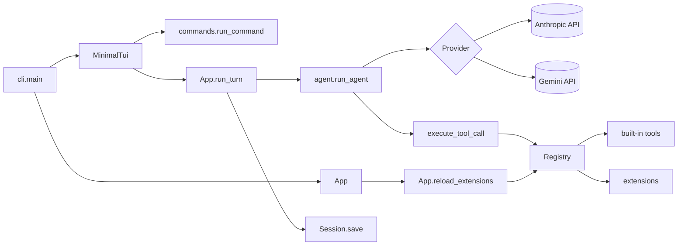

# minimal

A minimal, extensible coding-agent harness for the terminal, in Python 3.11+. It works with Claude (Anthropic) and Gemini (Google), and more model integrations can be added as providers.

```
src/minimal/
  providers/
    base.py        Provider interface, Reply, canonical message format
    anthropic.py   Claude via the Anthropic Messages API (API key)
    claude.py      Claude via a Pro/Max subscription (browser login)
    claude_auth.py browser login (OAuth PKCE) and token storage (~/.minimal/claude-auth.json)
    gemini.py      Gemini via the Google Interactions API
  registry.py    Registry, Tool, Command, WidgetSpec: where tools, commands, providers, hooks and widgets are registered
  tools.py       built-in tools: read, write, edit, bash, reload_extensions
  extensions.py  finds extension files and calls their register(minimal)
  marketplace.py git-based extension marketplaces: list, search, install, publish (~/.minimal/marketplace cache)
  session.py     JSONL sessions (~/.minimal/sessions)
  agent.py       agent loop (model → tools → model …)
  app.py         App: runtime state, provider switching, system prompt, one user turn, extension reload, Frontend
  commands.py    slash commands (/help, /provider, /reload, /ext, …)
  config.py      default provider/model, API keys, added marketplaces and UI theme (~/.minimal/config.json, keys.json, marketplaces.json, theme.json)
  setup.py       onboarding wizard: provider, login or API key, model
  theme.py       the built-in black-and-white theme, building extension themes for Textual, and the glyphs of the terminal UI
  tui.py         Textual terminal UI: welcome header, transcript, tool-call blocks, prompt, status line, confirm dialog, extension widget areas
  cli.py         option parsing, entry point
extensions/
  example.py     example extension (tool, command, guardrail, prompt note, sidebar widget)
tests/
  test_smoke.py       tools, extensions, hot reload, agent loop, sessions
  test_providers.py   provider conversions (Gemini history/streaming, Anthropic/Claude request)
  test_claude_auth.py browser login round trip, token refresh
  test_config.py      saved keys and config, how the startup provider is chosen
  test_marketplace.py search, install, publish, the /ext picker and saved marketplaces against local bare git repositories
  test_tui.py         the terminal UI: streaming, confirm, checklist and text dialogs, tool-call states, command output, widgets
```

## Architecture



One user turn: `App.run_turn` appends the user message and calls `run_agent`. The loop asks the current provider for a reply. If the reply calls tools, each call goes through `tool_call` handlers (which can veto it), user confirmation, the tool itself, and `tool_result` handlers (which can rewrite the output). The results go back to the model, and this repeats until it answers without tools. If anything fails mid-turn, the turn is dropped from the history. The session file is appended to after every turn.

What the user sees goes through a `Frontend` (`app.py`): the terminal UI's, or `ConsoleFrontend` (plain stdout) for `-p`. In the terminal UI, turns and slash commands run in a worker thread; streamed text, tool calls, tool results and confirmation dialogs are handed to the UI thread, and anything printed appears in the transcript.

The terminal UI follows omp/pi: a welcome header, user messages on a tinted band, replies rendered as Markdown, and each tool call as a block whose background shows its state (running, done, failed). The block's header line is `$ command` for `bash` or `read`/`write`/`edit <path>`; under it, a preview of the output, the content written, or the diff of an edit. Below the prompt, a status line shows the model, provider, directory and git branch (`*` when there are uncommitted changes). Colours and glyphs live in `theme.py`. The built-in theme is `minimal` (black and white); more come from extensions, such as `amber`, `dark` and `light` in the marketplace's `themes/` (install them with `/ext` → Themes). Switch with `/theme` (a picker) or `/theme <name>`, or with ctrl+p → Theme; the choice is saved in `~/.minimal/theme.json`.

History is stored in one provider-neutral format, shaped like the Anthropic Messages API (see `providers/base.py`). Each provider converts it to its own API on every request, so you can switch providers mid-conversation and resume any session with any provider. When a provider must replay its own replies exactly (Gemini's thought signatures), it keeps that data in the message's `provider_data`. Other providers ignore it.

Every module has a docstring describing its role; start with `src/minimal/__init__.py`.

## Usage

```bash
uv sync
uv run minimal                                   # first run: setup, then the terminal UI
uv run minimal --setup                           # change the default provider, login/key or model later

uv run minimal -p "summarize this repo"          # single pass
uv run minimal -c                                # resume the last session
uv run minimal -e extensions/example.py
uv tool install .                                # optional: install the `minimal` command globally
```

On the first start, setup asks (arrow keys) for the default provider, then its credentials (a browser login for `claude`; for an API-key provider, the key from the environment or a new one), then the model, and saves the choice in `~/.minimal/config.json`. It runs again when the saved provider can no longer start (for example after `minimal --logout`), and on demand with `minimal --setup` or `/setup`. Keys entered in setup are saved in `~/.minimal/keys.json` (mode 0600) and used instead of the environment variables. Without a terminal (a pipe, CI), there is no setup: save a choice first or pass `--provider`.

| Provider | `--provider` | Credentials | Default model |
|---|---|---|---|
| Anthropic | `anthropic` | `ANTHROPIC_API_KEY` or a key saved in setup | `claude-sonnet-5-5` |
| Claude subscription | `claude` | browser login in setup, `minimal --login` or `/login` | `claude-sonnet-5-5` |
| Google Gemini | `gemini` | `GEMINI_API_KEY`/`GOOGLE_API_KEY` or a key saved in setup ([get one](https://aistudio.google.com/docs/api-key), free tier) | `gemini-3.8-flash` |

Provider: `--provider <name>`, else `MINIMAL_PROVIDER`, else the one saved by setup. Model: `-m <model>`, else `MINIMAL_MODEL`, else the one saved by setup (if the provider is the saved one), else the provider's default. `-s <id>` opens a specific session, `-y` skips confirmations.
By default it asks for permission before running `write`, `edit`, `bash`, `reload_extensions`, `ext_install` and `ext_publish`.

Commands: `/help`, `/new`, `/sessions`, `/model [name]`, `/provider [name [model]]`, `/tools`, `/reload`, `/ext …`, `/setup`, `/login`, `/logout`, `/exit`, plus any added by your extensions. `/provider` with no argument lists the providers; `/provider gemini` switches to Gemini for this session and keeps the conversation (`/setup` changes the saved default). `/login` signs in and switches the session to `claude`. `/setup` and `/login` run with the UI suspended, in the plain terminal. `Ctrl+Q` or `/exit` quits; `Ctrl+P` opens the command palette.

The interactive UI needs a terminal: without one (a pipe, CI) use `-p`.

If there is an `AGENTS.md` in the current directory, it is added to the system prompt.

## Extensions

A Python file defining `register(minimal)`. Extensions are loaded from `~/.minimal/extensions/`, `./.minimal/extensions/` and any paths passed with `--ext` (files starting with `_` are skipped). Each folder's own files load first, then those in its `themes/`, `tools/` and `widgets/` subfolders, where the marketplace installs those categories.

```python
def register(minimal):
    minimal.register_tool(name="hello", description="...", input_schema={...}, run=lambda input, ctx: "text")
    minimal.register_command("hi", lambda args, ctx: print("hi", args), description="say hi")
    minimal.register_command("wizard", run_wizard, terminal=True)                  # needs the real terminal
    minimal.register_provider("myllm", create=MyProvider, default_model="my-model", env_keys=("MYLLM_KEY",))
    minimal.on("tool_call", lambda e: {"block": True, "reason": "no"})              # veto a call
    minimal.on("tool_result", lambda e: {"output": e["output"].upper()})            # rewrite a result
    minimal.on("turn_end", lambda e: None)                                          # e["messages"]
    minimal.append_system_prompt("Extra instructions for the model.")
    minimal.register_widget("panel", lambda ctx: MyPanel(), area="sidebar")         # top, bottom or sidebar
    minimal.register_theme("ocean", dark=True, background="#0b1622", foreground="#d0e4f5", accent="#4fc3f7")
```

`ctx` exposes `cwd`, `messages`, `provider_name`, `model` and `registry`. Errors raised by a tool are returned to the model as an `is_error` result, so it can correct itself.

A widget is any [Textual](https://textual.textualize.io/) widget, styled with its own `DEFAULT_CSS`. Besides Textual's standard variables (`$primary`, `$surface`, …), the CSS can use the theme's own: `$muted`, `$dim`, `$border-muted`, `$user-message-bg`, `$tool-success-bg`, … (see `theme.py`). If it has a `refresh_state(ctx)` method, the UI calls it after mount, after every turn and command, and after every reload. The `top` and `bottom` areas size to their content: give the widget a height and don't `dock` it.

A theme needs `background`, `foreground` and `accent` (`#rrggbb`); the other colours (`surface`, `muted`, `error`, `user_bg`, `diff_added`, … see `Registry.register_theme`) are optional and derived when left out. Registered themes appear in `/theme` and ctrl+p → Theme; the built-in `minimal` cannot be replaced. If a reload removes the active theme, the UI goes back to `minimal`.

### Self-extension and hot reload

The model knows how to write extensions (the system prompt explains the API and where to save them). After writing or editing one, it calls the `reload_extensions` tool, which asks for confirmation like `write` (skipped with `-y`). Reloading rebuilds the registry from disk in place, so new tools are offered on the model's next request, even in the middle of a turn, and widgets are remounted without restarting. Load errors are returned to the model so it can fix them. You can reload yourself with `/reload`.

### Marketplace

Extensions are shared through a git repository with one folder per category: `extensions/` (general), `themes/` (colour themes), `tools/` (tools for the model) and `widgets/` (terminal UI components), each holding `<name>.py` files whose docstring's first line is the description and an optional `__version__ = "1.0"` the version. Installing mirrors the category, so `themes/amber.py` goes to `~/.minimal/extensions/themes/amber.py`. The default is `https://github.com/RafaSG13/minimal-marketplace.git`; `MINIMAL_MARKETPLACE` adds another URL or a local path (for example your fork) and makes it the one the model's tools use.

```
/ext                              pick a marketplace and a category, then tick items to install, update or remove
/ext list                         list installed items by scope and category
/ext publish <path> [name]        push a publish/<name>-<timestamp> branch and open a pull request (with `gh`)
```

`/ext` opens a dialog with the marketplaces: the default, `$MINIMAL_MARKETPLACE` and the ones you added. "Add a marketplace…" takes a git URL or a local path, checks that it can be cloned and saves it in `~/.minimal/marketplaces.json`; "Remove a saved marketplace…" forgets one. Picking a marketplace lists its categories with how many items each has and how many are installed; picking a category shows a checklist of its items with the installed ones ticked: tick to install (you then choose the global or the project folder), untick to uninstall. Installed items whose file differs from the marketplace's are offered for update. Space toggles, Enter applies, Esc cancels without changing anything; the extensions are reloaded afterwards. `/ext publish` files a file under the category of the folder it comes from (`~/.minimal/extensions/themes/x.py` → `themes/`), else under `extensions/`.

The model has the `ext_search`, `ext_install` and `ext_publish` tools (each takes an optional `category`), which use `$MINIMAL_MARKETPLACE` or the default; it must call `reload_extensions` after installing. Publishing never pushes to the default branch: without push access, fork the marketplace and point `MINIMAL_MARKETPLACE` at the fork.

## Adding a provider

A provider is a class with a `name` and a `stream(*, model, system, messages, tools, on_text) -> Reply` method (see `providers/base.py`):

1. Convert the canonical `messages` and `tools` to the API's request format.
2. Stream the response, calling `on_text(chunk)` for text as it arrives.
3. Return `Reply(content=[text/tool_use blocks], stop_reason="tool_use" | "end_turn" | ..., provider_data=...)`.

Register it as a built-in in `providers/__init__.py` (`BUILTIN_PROVIDERS`), or from an extension with `minimal.register_provider(...)`. `providers/gemini.py` is a complete example, including the history conversion.

## Tests

```bash
uv run python -m unittest discover -s tests   # no network or API key: tools, extensions, reload, the loop with a fake provider, provider conversions, marketplace (local git), the UI (headless)
```

## Ideas to extend it

- `grep`/`glob` tools, or a web-search tool as an extension.
- Compact the history when the session grows (an extension on `turn_end`).
- Subagents: a tool that calls `run_agent` with its own message history.
- Prompt caching: add `cache_control` to the system prompt and the last tool.
